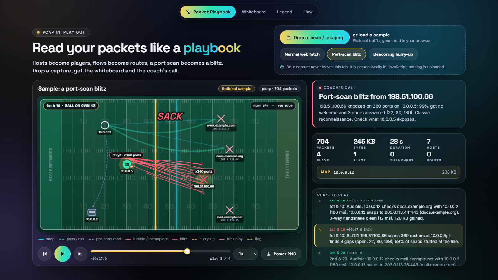
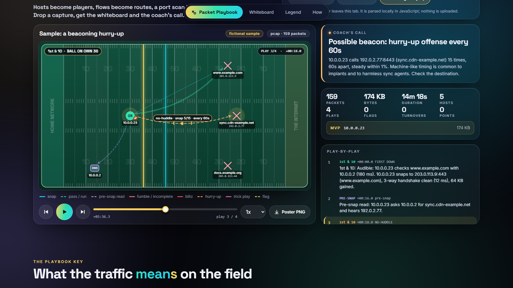

# PACKET PLAYBOOK

Drop a packet capture and read it as a football play: hosts are players, flows are routes, a port scan is a blitz.

**[Live demo](https://tootenramen.github.io/Packet-Playbook/)**

## What you can do
- Drop a `.pcap` / `.pcapng` (or load one of three fictional sample plays) and get a coach's whiteboard of what the traffic did.
- Scrub or play the drive: route arrows draw in, the ball moves, the chains advance. Step play by play, any speed.
- Read the announcer: numbered plays with down and distance ("1st & 10: 10.0.0.5 snaps to 203.0.113.9:443, 3-way handshake clean, 42 KB gained").
- Get the Coach's call: normal web fetch, port-scan blitz, hurry-up beacon, DNS trick play, big outbound haul. Plus a scoreboard and an MVP top talker.
- Export the whiteboard as a poster PNG.

## How it works
Everything runs in your browser. A small JavaScript reader parses pcap and pcapng (Ethernet, raw IP, Linux cooked), stitches packets into TCP flows (handshake, retransmits, resets), DNS lookups, UDP streams and ICMP, then applies simple explainable heuristics for scans, beaconing and DNS tunnelling. Nothing is uploaded, no analytics, no server. Samples are generated in JS from documentation address ranges only.

Honest notes: the football mapping is a metaphor and the verdicts are heuristics, so treat them as leads, not rulings. Yardage is a log scale of bytes. Very large captures are capped (first 400k packets, and the 44 biggest plays are drawn). No decryption; TLS contents stay opaque.

**Skills this shows:** network forensics and packet parsing, detection heuristics, canvas visualisation, accessible UI, privacy-first client-side design.

Built by Gustavo Freitas - [LinkedIn](https://www.linkedin.com/in/gustavo-freitas-69b93910b/) - [more projects](https://github.com/Tootenramen)
